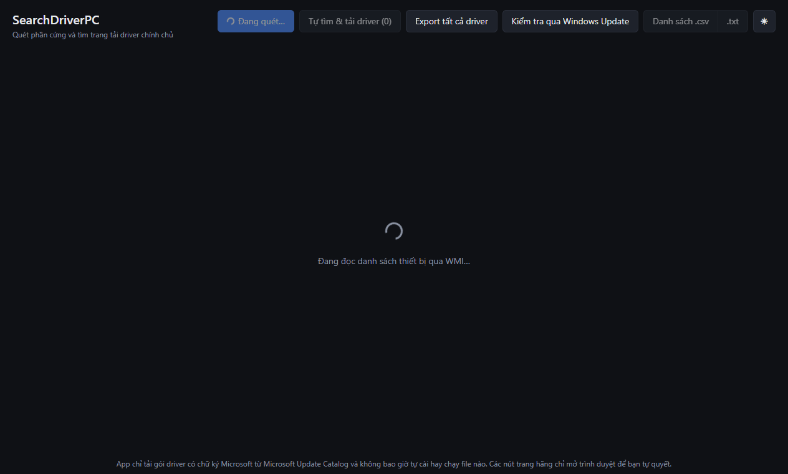
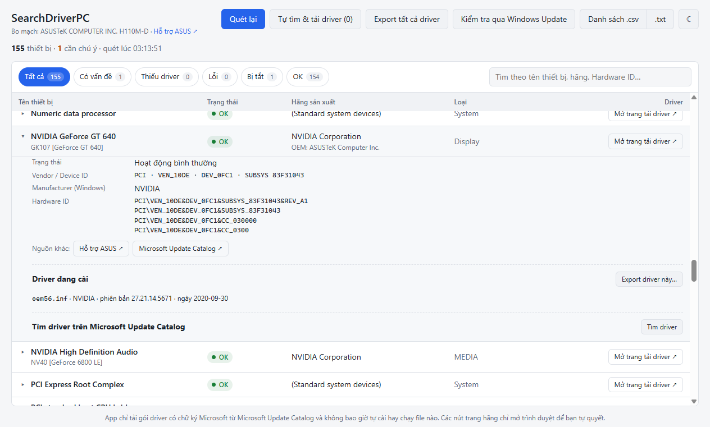
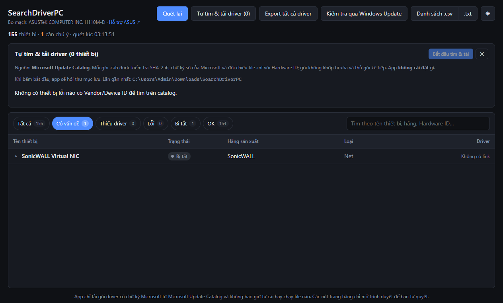

# SearchDriverPC

> Tìm driver cho Windows một cách minh bạch: quét phần cứng, chỉ ra thiết bị thiếu hoặc lỗi driver, dẫn
> bạn tới **nguồn chính chủ**, và **không bao giờ tự cài hay chạy bất cứ thứ gì**.

*English summary: an open-source Windows desktop app (Electron + React + TypeScript) that scans your
hardware via WMI, identifies devices with missing or broken drivers, looks up vendor/device names
offline, links to official vendor download pages, optionally downloads Microsoft-signed driver packages
from the Microsoft Update Catalog (verified, never installed), and backs up installed drivers.*



## Vì sao có dự án này

Nhiều công cụ "driver updater" tự tải và tự cài file từ những nguồn không rõ ràng. SearchDriverPC làm
ngược lại: nó chỉ cho bạn thấy máy đang thiếu gì và nên lấy driver ở đâu. Việc cài đặt luôn do bạn tự
làm:

- Chỉ mở trang của hãng (Intel, AMD, NVIDIA, Realtek, ASUS, Dell, HP, Lenovo…) trong trình duyệt.
- Chỉ tải từ **Microsoft Update Catalog**. Gói nào cũng phải qua bước kiểm tra hash và chữ ký số của
  Microsoft.
- Chạy với **quyền user thường**, không cần admin.
- Mã nguồn mở. Mọi lệnh hệ thống app gọi đều có trong code để bạn tự kiểm tra.

## Tính năng

| | |
| --- | --- |
| 🔍 **Quét phần cứng** | Đọc toàn bộ thiết bị Plug and Play qua WMI (`Win32_PnPEntity`). Dịch mã lỗi Device Manager (Code 28, 10, 43…) sang trạng thái dễ hiểu: **OK / Thiếu driver / Lỗi / Bị tắt**, kèm gợi ý khắc phục. |
| 🏷️ **Nhận diện offline** | Tách Hardware ID (`VEN_/DEV_`, `VID_/PID_`, `SUBSYS_`) và tra trong `pci.ids` / `usb.ids` có sẵn trong app. Thiết bị chỉ hiện "Unknown device" vẫn ra được tên chip thật và hãng lắp ráp. |
| 🌐 **Trang driver chính chủ** | Mỗi thiết bị có nút mở trang của hãng chip, hãng máy (OEM) hoặc Microsoft Update Catalog. |
| 🪟 **Windows Update** | Kiểm tra driver tùy chọn (Optional updates) đang có sẵn. App chỉ tìm, không tải hay cài. |
| ⬇️ **Tìm & tải driver (không cài)** | Tìm trên Microsoft Update Catalog, xếp hạng gói theo phiên bản Windows và kiến trúc CPU. Có thể tải từng gói, từng thiết bị hoặc cả loạt thiết bị lỗi. **Bạn chọn thư mục lưu mỗi lần tải.** |
| 💾 **Export driver** | Sao lưu driver đang cài của một thiết bị, hoặc **export toàn bộ** driver bên thứ ba ra thư mục bạn chọn, kèm danh sách và hướng dẫn khôi phục. |
| 📄 **Xuất danh sách** | Xuất danh sách thiết bị có vấn đề ra `.csv` (mở tốt trong Excel) hoặc `.txt` để tự tra cứu hay gửi người hỗ trợ. |
| 🎨 **Giao diện** | Bảng lọc theo trạng thái, tìm theo tên/hãng/Hardware ID, dark/light mode. |

<details>
<summary>Thêm ảnh chụp màn hình</summary>




</details>

## Cài đặt & chạy

### Yêu cầu

- **Windows 10 hoặc 11** (x64). App dùng WMI, PowerShell 5.1, `pnputil`, `expand.exe`, đều có sẵn trong Windows.
- Để build từ mã nguồn: **Node.js 20+** (khuyến nghị bản LTS mới nhất) và **Git**.

### Cách 1 — Chạy từ mã nguồn

```powershell
git clone https://github.com/canona/searchdriverpc.git
cd searchdriverpc
npm install
npm start
```

`npm start` build giao diện và main process rồi mở app. Lần chạy đầu, app tự quét phần cứng, thường mất
vài giây.

### Cách 2 — Tự đóng gói bản cài đặt (.exe)

```powershell
npm install
npm run dist
```

Bộ cài NSIS được tạo trong thư mục `release/`. Bộ cài chạy với quyền user thường (`asInvoker`).

### Các lệnh khác

| Lệnh | Tác dụng |
| --- | --- |
| `npm run dev` | Chạy Vite dev server + Electron, giao diện tự reload khi sửa code |
| `npm run typecheck` | Kiểm tra kiểu TypeScript cho cả renderer và main process |
| `npm test` | Chạy unit test (parse Hardware ID, pci.ids, catalog, xếp hạng, export, allowlist URL…) |
| `npm run build` | Chỉ build, không chạy |

### Xử lý sự cố khi cài

- **`npm install` báo `ENOSPC` / thiếu dung lượng**: npm và Electron để cache trên ổ C. Có thể chuyển
  cache sang ổ khác:
  ```powershell
  $env:npm_config_cache = "D:\npm-cache"
  $env:ELECTRON_CACHE   = "D:\electron-cache"
  npm install
  ```
- **App mở ra nhưng Electron chạy như Node (`require('electron')` là `undefined`)**: môi trường đang đặt
  biến `ELECTRON_RUN_AS_NODE=1` (thường gặp khi chạy từ terminal của một số extension). Chạy
  `Remove-Item Env:ELECTRON_RUN_AS_NODE` rồi thử lại.
- **PowerShell bị chặn bởi chính sách công ty**: app gọi PowerShell với `-ExecutionPolicy Bypass` cho các
  script viết sẵn trong code. Nếu Group Policy cấm hoàn toàn PowerShell thì app không quét được.

## Hướng dẫn sử dụng

1. **Mở app.** Danh sách thiết bị hiện ra, thiết bị có vấn đề nằm trên cùng. Bộ lọc mặc định là
   *Có vấn đề*.
2. **Xem chi tiết.** Bấm vào một dòng để xem mã lỗi, gợi ý khắc phục, Vendor/Device ID, toàn bộ Hardware
   ID và driver đang cài.
3. **Lấy driver**, chọn một trong các cách:
   - **Mở trang tải driver ↗**: mở trang chính chủ trong trình duyệt để bạn tự tìm và tải.
   - **Tìm & tải**: app hỏi thư mục lưu, tìm trên Microsoft Update Catalog rồi tải gói phù hợp nhất đã
     qua kiểm tra.
   - **Tự tìm & tải driver (N)** trên thanh đầu: làm như trên cho mọi thiết bị lỗi, thư mục lưu chỉ hỏi
     một lần.
   - **Kiểm tra qua Windows Update**: xem Windows Update có sẵn driver nào không, rồi cài trong
     Settings › Windows Update › Optional updates.
4. **Tự cài gói đã tải** (cần quyền admin): Device Manager → chuột phải thiết bị → *Update driver* →
   *Browse my computer for drivers* → chọn thư mục `driver\` của gói. Mỗi gói có kèm file
   `HUONG-DAN-CAI-DAT.txt`.
5. **Sao lưu driver**: dùng *Export driver này…* trong chi tiết thiết bị, hoặc **Export tất cả driver**
   trên thanh đầu. Thư mục sao lưu có `HUONG-DAN-KHOI-PHUC.txt`, trong đó có lệnh khôi phục một lần
   cho tất cả (bạn tự chạy với quyền admin).

## App hoạt động thế nào

<details>
<summary>Quét và nhận diện</summary>

- PowerShell `Get-CimInstance Win32_PnPEntity` lấy `Name`, `HardwareID[]`, `ConfigManagerErrorCode`,
  `Present`… Việc này chỉ đọc, không cần admin.
- Hardware ID như `PCI\VEN_10EC&DEV_8168&SUBSYS_86771043&REV_15` được tách thành vendor `10EC` (Realtek),
  device `8168`, subsystem vendor `1043` (ASUS) và subsystem device `8677`.
- PCI và HD Audio tra trong `pci.ids`; USB và HID tra trong `usb.ids`. ACPI dùng mã chữ (vd `INT33A0`)
  nên không tra được, app sẽ gợi ý trang hãng máy.

</details>

<details>
<summary>Tìm & tải từ Microsoft Update Catalog</summary>

1. Tìm theo Hardware ID có `SUBSYS` (khớp đúng model máy) và theo `VEN/DEV`, rồi bỏ gói sai kiến trúc
   CPU hoặc chỉ dành cho Windows đời cũ.
2. Lấy link tải. App chỉ chấp nhận file `.cab` trên `*.download.windowsupdate.com` /
   `*.delivery.mp.microsoft.com` qua HTTPS.
3. Tải về, tính **SHA-256** trong lúc tải, rồi so với giá trị catalog công bố.
4. Kiểm tra **chữ ký Authenticode**: trạng thái phải `Valid` và người ký là Microsoft Corporation.
5. Giải nén bằng `expand.exe` của Windows. Chỉ giải nén, không chạy gì.
6. Kiểm tra có file `.inf` liệt kê Hardware ID của thiết bị hay không. Chế độ tự động thử tối đa 3 gói
   và xóa gói không khớp.

Sai ở bất kỳ bước nào, thư mục của gói đó bị xóa ngay.

</details>

<details>
<summary>Export driver</summary>

`pnputil /export-driver <oemXX.inf | *> <thư mục>` sao chép gói từ Driver Store ra thư mục bạn chọn.
Lệnh này không thay đổi hệ thống. Tiến trình được tính theo số thư mục con tạo ra, vì output của
pnputil bị dịch theo ngôn ngữ Windows nên app không đọc chữ trong đó.

</details>

## Bảo mật & quyền riêng tư

- Không có telemetry. Mạng chỉ được dùng khi bạn bấm tìm/tải trên Microsoft Update Catalog (gửi Hardware
  ID để tìm kiếm) hoặc kiểm tra Windows Update. Phần tra tên thiết bị chạy hoàn toàn offline.
- Renderer chạy trong sandbox (`contextIsolation`, không `nodeIntegration`, CSP chặt) và chỉ gọi được các
  hàm khai báo trong `preload.ts`.
- Link ngoài phải là `https` thuộc allowlist domain chính chủ. Renderer không truyền được URL tải hay
  đường dẫn tùy ý cho main process.
- Script PowerShell viết cứng trong code. Tham số được truyền qua biến môi trường, không ghép chuỗi.

Nếu bạn phát hiện lỗ hổng bảo mật, vui lòng báo riêng qua GitHub (Security › Report a vulnerability),
đừng mở issue công khai.

## Cấu trúc mã nguồn

```
electron/      main process: quét WMI, parse ID, catalog, tải/xác minh, export, IPC
src/           giao diện React (App, components/, hooks/)
resources/     pci.ids, usb.ids (dữ liệu offline)
docs/          ảnh chụp màn hình
CLAUDE.md      yêu cầu, ràng buộc và quy ước chi tiết của dự án
```

Chi tiết từng module, các ràng buộc bắt buộc và quy ước code có trong [CLAUDE.md](CLAUDE.md).

## Đóng góp

Rất hoan nghênh issue và pull request! Vài điểm cần lưu ý:

- **Giữ nguyên ràng buộc cốt lõi**: app không tự cài driver, không chạy file tải về, không tải từ nguồn
  ngoài Microsoft Update Catalog, và không đòi quyền admin. PR vi phạm các điểm này sẽ không được nhận.
- Thêm hãng vào bảng link chính chủ: sửa `electron/vendorLinks.ts`. Allowlist tự cập nhật theo bảng.
- Trước khi gửi PR, chạy `npm run typecheck` và `npm test`.
- Comment và chuỗi giao diện viết bằng tiếng Việt, tên biến/hàm bằng tiếng Anh.

Muốn cập nhật database ID:

```powershell
curl.exe -L -o resources/pci.ids https://pci-ids.ucw.cz/v2.2/pci.ids
curl.exe -L -o resources/usb.ids http://www.linux-usb.org/usb.ids
```

## Nguồn dữ liệu & giấy phép

- Mã nguồn: [MIT License](LICENSE).
- `resources/pci.ids`: [The PCI ID Repository](https://pci-ids.ucw.cz/), phát hành theo GNU GPL v2+
  hoặc BSD 3-clause.
- `resources/usb.ids`: [The Linux USB ID Repository](http://www.linux-usb.org/usb-ids.html), phát hành
  theo GNU GPL v2+ hoặc BSD 3-clause.
- Tên và thương hiệu của các hãng chỉ được dùng để nhận diện thiết bị và dẫn link tới trang chính thức
  của họ. Dự án không liên kết với Microsoft hay bất kỳ hãng phần cứng nào.

## Miễn trừ trách nhiệm

Phần mềm được cung cấp "nguyên trạng". Việc cài driver luôn do bạn tự quyết. Nên tạo điểm khôi phục
hệ thống (System Restore) hoặc dùng tính năng Export driver để sao lưu trước khi cài.
